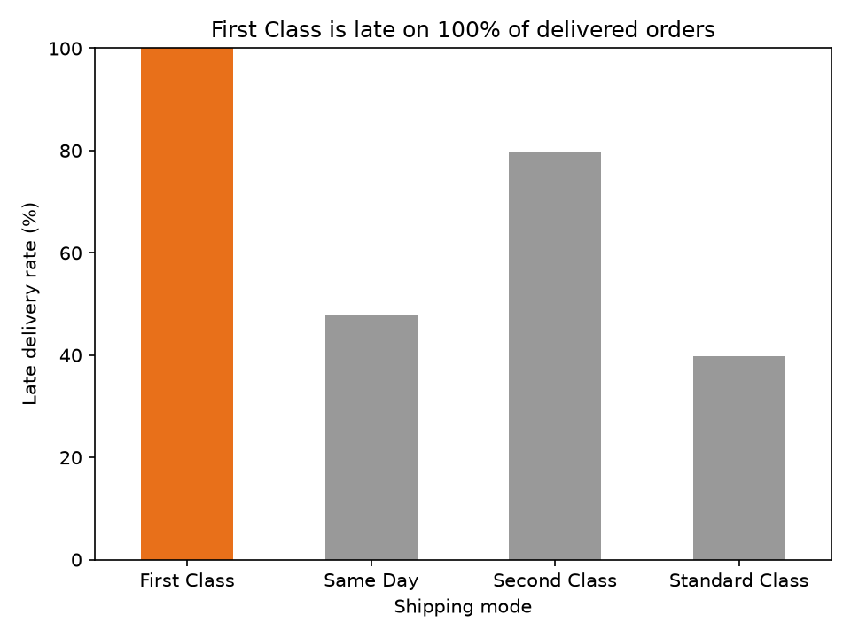
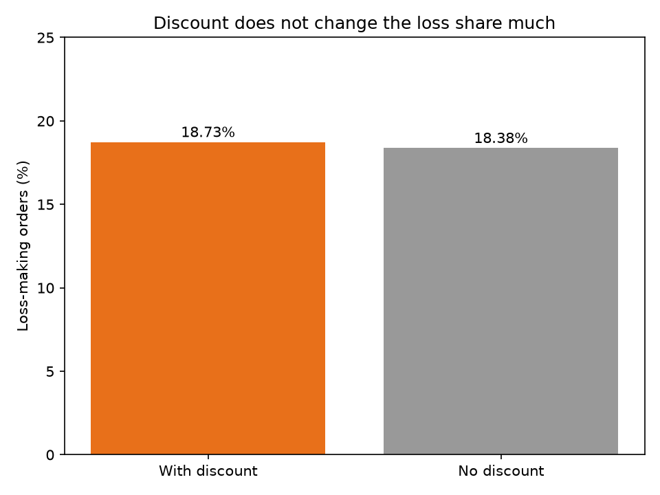
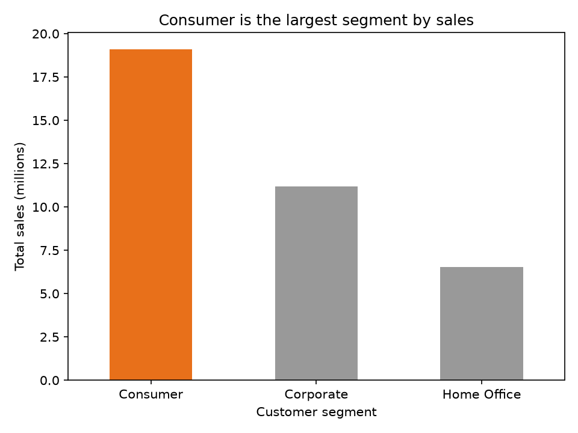

# Supply Chain Operations Analysis (Python, pandas)

An analysis of 180,519 order lines from the DataCo SMART Supply Chain dataset. It answers three operations and sales questions, checks the data before analysis, and lists the limits of the data.

**Tools:** Python, pandas, matplotlib, Jupyter, Excel (reconciliation only)

---

## Business Questions

**Stakeholder:** Operations and logistics planning team of a retail company.

1. **Delivery promise:** Are the scheduled delivery days realistic for each shipping mode?
2. **Discounts:** Do discounted orders have a higher share of loss-making orders?
3. **Customer segment:** Which customer segment gives the most sales and profit per order?

---

## Short Answers

| Question | Answer | Evidence |
|---|---|---|
| 1. Delivery promise | **No for First Class.** Every delivered First Class order took exactly 1 day longer than the scheduled time. Average real time is 2.0 days against 1.0 scheduled day for delivered orders. | Chart 1, delay table, Step 21 (Findings, Q1) |
| 2. Discounts | **No meaningful difference.** Loss share is 18.73% for discounted orders and 18.38% for non-discounted orders. Discount alone does not explain loss in this data. | Chart 2 (Findings, Q2) |
| 3. Customer segment | **Consumer** has the largest total sales (about 19.10 million) and the highest average profit per order (22.18). The gap in profit per order is small. | Chart 3 (Findings, Q3) |

---

## Recommendations

1. **First Class promise:** Review the scheduled delivery days for First Class with the operations team. The data suggests a 2-day promise would match the average real time. Confirm this with operations before any change.
2. **Discounts:** Do not treat discounts as the main cause of losses. The next step is to analyse product category and discount depth. This was not done in this project.
3. **Segments:** Consumer is the largest segment, but the profit-per-order gap is small. Test the difference before changing priorities.

---

## Dataset

- **Name:** DataCo SMART Supply Chain
- **Source:** Constante, F., Silva, F., and Pereira, A. (2019). *DataCo Smart Supply Chain for Big Data Analysis.* Mendeley Data, V5. doi: [10.17632/8gx2fvg2k6.5](https://doi.org/10.17632/8gx2fvg2k6.5)
- **Licence:** CC BY 4.0 (Mendeley Data V5). Note: a Kaggle listing of the same dataset says CC0. This project cites the Mendeley version and its licence.
- **Size:** 180,519 rows, 53 columns. One row per order item.
- **Date range:** 2015-01-01 to 2018-01-31.
- **Status:** Public dataset. It is not verified as data from a real company. See Limitations.

---

## Privacy

Personal and location columns were removed before analysis. The raw data is not included in this repository.

**Removed for privacy (6):** Customer Email, Customer Fname, Customer Lname, Customer Password, Customer Street, Customer Zipcode

**Removed as empty or not needed for the questions (4):** Product Description, Order Zipcode, Latitude, Longitude

**Kept:** Customer Id (an internal ID), city and state. Location details were removed to reduce the risk of identifying customers.

---

## Data Quality Checks

| Check | Result |
|---|---|
| Rows loaded | 180,519 |
| Columns (raw) | 53 |
| Duplicate Order Item Id | 0 |
| Missing values | Product Description 180,519 (100%), Order Zipcode 155,679 (86.24%), Customer Lname 8, Customer Zipcode 3. All other columns: 0. |
| Shipping date before order date | 0 |
| Date gap different from "Days for shipping (real)" | 4,657 rows, all Same Day |
| Same Day, real days | 0 days: 5,080 · 1 day: 4,657 |
| Same Day, date gap | 0 days for all 9,737 Same Day rows |

**Interpretation of the Same Day mismatch:** For Same Day orders, the date gap is always 0, but the real-days column is sometimes 1. The date gap is therefore unreliable for Same Day orders. The analysis uses the "Days for shipping (real)" column instead.

---

## Cleaning Log

| Step | Rows | Columns | Note |
|---|---|---|---|
| Raw file loaded (`latin-1` encoding) | 180,519 | 53 | Encoding needed to read the file |
| Privacy and unused columns removed | 180,519 | 43 | 10 columns removed (see Privacy) |
| Duplicate check on Order Item Id | 180,519 | 43 | 0 duplicates, nothing removed |
| Date columns converted to datetime | 180,519 | 45 | `order date` and `shipping date` added |
| Delay column added | 180,519 | 46 | `delay_days` added |
| Delivered orders used for delay analysis | 172,765 | 46 | 7,754 canceled orders excluded from delay analysis |

---

## Definitions

- **delay_days** = Days for shipping (real) minus Days for shipment (scheduled). Positive means late, zero means on time, negative means early.
- **Late** = `Late_delivery_risk` = 1, the flag in the source data. It matches `delay_days > 0` except for 4,423 canceled orders.
- **Delivered** = Delivery Status is not "Shipping canceled" (172,765 orders).
- **Loss-making order** = Order Profit Per Order is below 0.
- **Loss share** = loss-making orders divided by all orders in the group.

---

## Findings

### Q1. Delivery promise by shipping mode

Delivered orders only (172,765).

| Shipping mode | Late % | Mean delay (days) |
|---|---|---|
| First Class | 100.00 | 1.00 |
| Second Class | 79.83 | 1.99 |
| Same Day | 47.93 | 0.48 |
| Standard Class | 39.77 | -0.01 |

- **First Class:** all 26,513 delivered orders have a delay of exactly 1 day. The promise is the same for every order, and it is always missed.
- **Second Class:** delay ranges from 0 to 4 days, with similar counts for each value.
- **Same Day:** delay is 0 or 1 day.
- **Standard Class:** delay ranges from -2 to 2 days, with similar counts for each value. The average is close to 0, but this hides a mix of early and late orders.

For delivered First Class orders (26,513), the average scheduled time is 1.0 day and the average real time is 2.0 days (Step 21).



### Q2. Discounts and loss-making orders

| Group | Orders | Loss share |
|---|---|---|
| With discount (discount rate above 0) | 170,491 | 18.73% |
| No discount (discount rate 0) | 10,028 | 18.38% |

The difference is under half a percentage point. This does not show that discounts drive losses. The difference was not tested for statistical significance.



### Q3. Sales and profit by customer segment

| Segment | Average profit per order | Total sales |
|---|---|---|
| Consumer | 22.18 | about 19.10 million |
| Corporate | 21.95 | about 11.17 million |
| Home Office | 21.44 | about 6.52 million |

- The three segment totals add up to the overall sales total of 36,784,735.01 (difference 0.0).
- Consumer is the largest segment by total sales and has the highest average profit per order. The profit-per-order gap between segments is small.



---

## Excel Reconciliation

Six key numbers from the Python analysis were recalculated in Excel from the source CSV. All six match:

1. Total rows: 180,519
2. Total sales: 36,784,735.01
3. Same Day, real days = 0: 5,080
4. Same Day, real days = 1: 4,657
5. Discounted orders: 170,491
6. Loss share, discounted orders: 18.73%

The reconciliation file (`outputs/p3_excel_validation.xlsx`) contains only these check results, not the raw data.

---

## Limitations

1. **The data may be simulated.** Delay patterns are very regular. First Class is always exactly 1 day late, and the other modes are spread evenly across a few values. The findings describe this dataset. They should not be read as the performance of a real company.
2. **`Late_delivery_risk` is an outcome flag, not a risk prediction.** It records whether an order was late. No prediction model was built.
3. **Canceled orders** (4,423 with a positive delay) are excluded from the delay analysis.
4. **The discount difference is not tested** for statistical significance. Only the group shares are reported.
5. **Segment differences are small.** The profit-per-order gap between segments is not tested for significance.
6. **2018 is a partial year.** The data ends on 31 January 2018, with 2,123 orders in 2018.
7. **Two columns are almost empty.** Product Description is empty for all rows, and Order Zipcode is empty for 86.24% of rows. Both were removed.
8. **Scope:** Product category and market analysis are not included, to keep the three questions focused.

---

## Project Structure

```
supply-chain-python-analysis/
├── README.md
├── .gitignore                       (excludes data/ and *.csv)
├── notebooks/
│   └── supply_chain_analysis.ipynb  (full analysis)
├── images/
│   ├── chart1_late_rate_by_mode.png
│   ├── chart2_discount_vs_loss.png
│   └── chart3_sales_by_segment.png
├── outputs/
│   └── p3_excel_validation.xlsx     (reconciliation results only)
└── data/                            (not in repository)
    └── DataCoSupplyChainDataset.csv
```

---

## How to Run

1. Install Python with pandas, matplotlib and Jupyter. The analysis was run with Python 3.14, pandas 3.0.3 and matplotlib 3.11.0.
2. Download the DataCo dataset from the Mendeley link above. Place `DataCoSupplyChainDataset.csv` in the `data/` folder. Only this file is used.
3. Open `notebooks/supply_chain_analysis.ipynb` in Jupyter. Run all cells from top to bottom (`Restart & Run All`). The notebook reads the data with relative paths, so it must be run from the `notebooks/` folder.
4. Charts are shown in the notebook and saved to `images/`.

---

## Licence and Citation

- **Dataset:** DataCo SMART Supply Chain. Constante, F., Silva, F., and Pereira, A. (2019). Mendeley Data, V5. CC BY 4.0. doi: 10.17632/8gx2fvg2k6.5
- **Analysis and code:** Shubham Mudgal, 2026.
